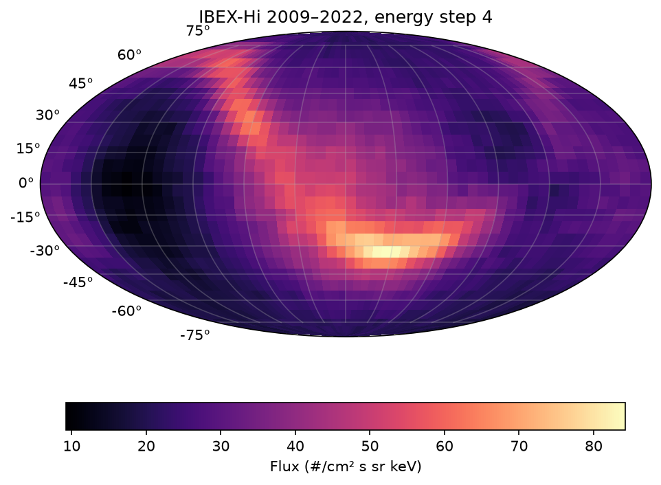

# IBEX Pipeline

 [](https://gitlab.com/larrymaes/ibex-pipeline/-/commits/main)

IBEX Pipeline downloads public sky maps from NASA's Interstellar Boundary Explorer (IBEX),
checks each file for problems, plots the maps, and reports what changed between two data
releases. It runs nightly from cron, logs every run, and stops before bad data can reach
the outputs. IBEX-Hi, the sensor these maps come from, was built by Los Alamos National
Laboratory and Southwest Research Institute.

This is a learning project for practicing data pipelines, Python, Bash, and Git.

## Status

Version 1 complete

- [x] Set up the environment and repo
- [x] Download IBEX-Hi maps from data releases 16 and 18
- [x] Read a map file and check it against its header
- [x] Plot an all-sky map
- [x] Compare the same maps across releases 16 and 18
- [x] Run the pipeline on a schedule with cron and log the results
- [x] Add a status report (last run, disk usage, errors)
- [x] Add GitLab CI for style checks and tests

## How it works

`run_pipeline.sh` runs each step in order and stops at the first failure:

| Step | Script | What it does |
|---|---|---|
| 1. Download | `fetch_data.sh` | Downloads 25 map files from NASA's CDAWeb mirror. Skips files it already has, so reruns only fetch what's missing. |
| 2. Check | `check_maps.py` | Checks every file: correct number of values, data range matches the header, no negative values. Reports unobserved pixels. Exits 1 on any problem. |
| 3. Compare | `compare_releases.py` | Compares the 2009A maps between releases 16 and 18 and writes `docs/compare_r16_r18.md`. |
| 4. Plot | `plot_map.py` | Draws an all-sky map of the 14-year data to `docs/ribbon_hi4.png`. |

Supporting pieces:

- `ibexmap.py`: shared `read_map()` function used by the plot and compare scripts
- `status.sh`: health report for weekly updates (last successful run, data files, storage, recent failures)
- `crontab.example`: nightly pipeline run and weekly status report
- `tests/`: unit tests for `read_map()`
- `.gitlab-ci.yml`: runs ruff (style) and pytest (tests) on every push

Every run is logged to `logs/pipeline_YYYY-MM-DD.log`. `logs/last_success` is only
updated when every step passes, and `flock` keeps two runs from overlapping.

## Usage

```bash
# Set up the environment
micromamba create -n ibex -c conda-forge python=3.12 numpy matplotlib pytest ruff
micromamba activate ibex

# Run the whole pipeline (output goes to logs/)
./run_pipeline.sh

# Check pipeline health
./status.sh

# Run the tests and style checks
pytest -v
ruff check .
ruff format --check .
```

To schedule it, add the lines from `crontab.example` with `crontab -e`.

## Tested failure path

To make sure the pipeline catches bad data, I truncated one map file on purpose:

1. `check_maps.py` flagged it (1,740 of 1,800 values) and the pipeline stopped with
   `FAILED at line 21` and exit code 1, before the compare and plot steps.
2. `logs/last_success` kept the time of the last good run, and `status.sh` reported the failure.
3. After deleting the bad file, the next run re-downloaded only that file and passed.

## Findings

### The IBEX ribbon



Fourteen years of IBEX-Hi data (2009–2022, energy step 4), centered on the heliosphere's
nose. The bright arc is the IBEX ribbon, discovered by IBEX in 2009.

### What changed between release 16 and release 18

Full table: [docs/compare_r16_r18.md](docs/compare_r16_r18.md)

- Release 18 changed nearly every observed flux pixel in the 2009A map, a small increase
  of about +0.4% to +1.9% (median), largest at low energies.
- It also dropped 25–27 low-energy pixels (steps 2–3) as unobserved. This matches the
  gap counts from `check_maps.py`.
- Exposure maps changed in 1,136 pixels, but by tiny amounts (median 0.00%).

## Data

IBEX data releases from the IBEX science team (https://ibex.princeton.edu/DataRelease),
mirrored by NASA's Space Physics Data Facility (https://cdaweb.gsfc.nasa.gov/pub/data/ibex/).
